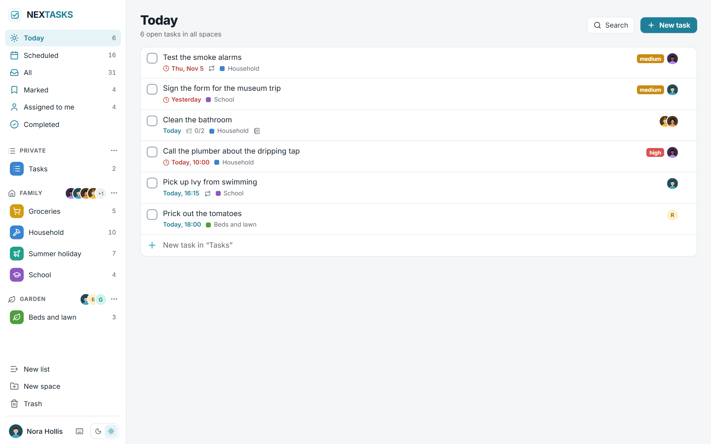
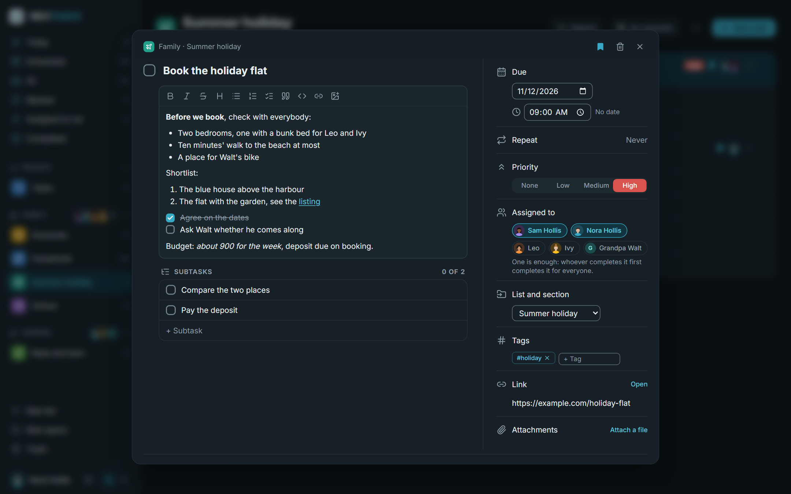
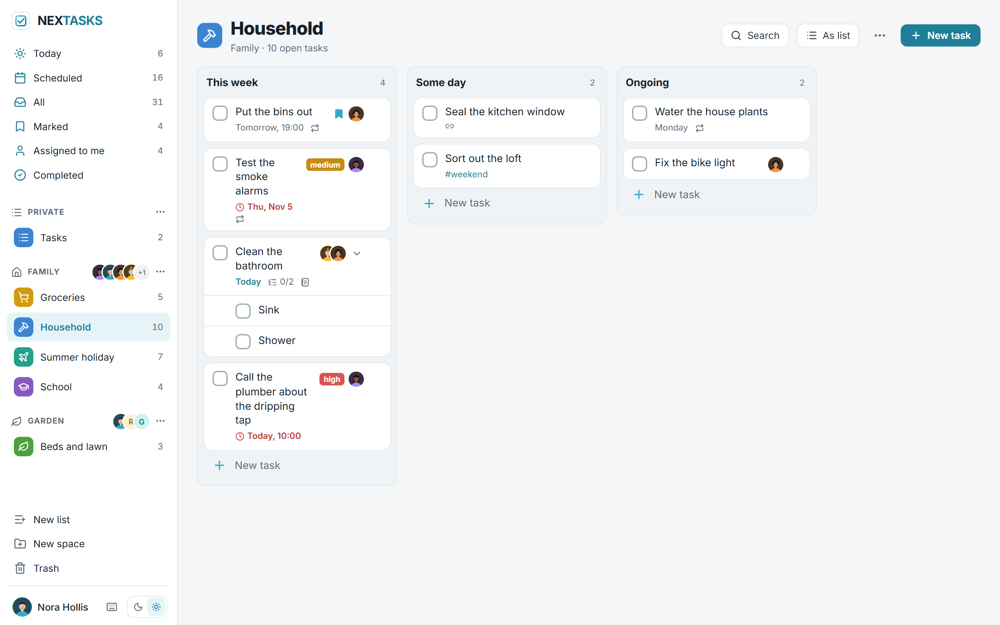
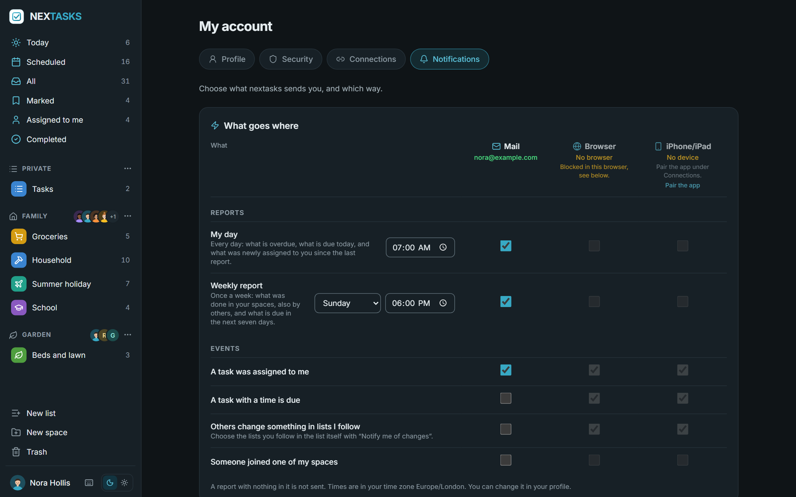
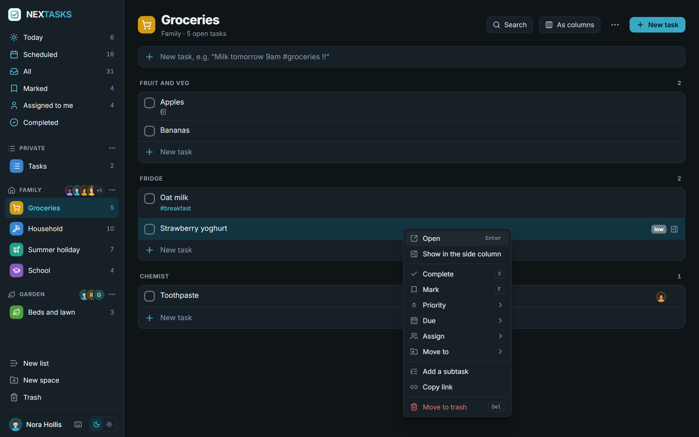
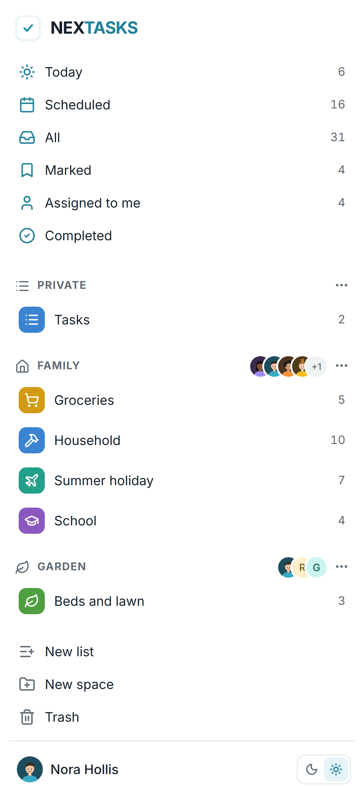

# nextasks

Tasks for families and small groups, on your own server. Spaces such as "Family" or "Garden" with their members and
lists, tasks with due dates, repeats, priorities, tags, subtasks and notes, assigned to one or more people of the
space: whoever ticks a task off first, ticks it off for everybody.

nextasks has a calm look of its own: petrol as the one accent, tick boxes, lists with a coloured plaque, light and
dark.

**Early days.** nextasks was rebuilt from the ground up in November 2026. Expect rough edges, and keep backups.



*Today, across every space: what is overdue and what is due today, with its list, its priority and who it is
assigned to. On the left the collections Scheduled, All, Marked, Assigned to me and Completed, then the spaces with
their members and lists.*

## Screenshots



*A task opens over the page, or in a column on the right. The note is Markdown with a toolbar: bold, lists, tick
boxes, links, pictures.*



*Every list can show its sections as columns. Tasks move between them by dragging.*



*One table says what goes where: the daily and the weekly report and single events, by mail, to the browser or to the
iPhone app.*

<p>
  
  
</p>

*A right click (or a long press) on a task, a list or a space opens its menu. On a phone the sidebar becomes a page of
its own, and nextasks installs from the browser as an app.*

## What it does

- **Spaces with members.** A manager of a space invites people by a link, or by mail once the operator has set up a
  mail server (for one person, valid seven days, used once), and changes who manages. Every member does everything
  with lists, sections and tasks. Every account also has a space "Private" of its own. A space can be hidden for
  oneself without leaving it.
- **Lists** in each space, with a colour and a symbol, divided into sections, shown as a list or as columns.
- **Tasks**: a title, a note in Markdown, a link, a due date with an optional time, repeats (daily to yearly, on
  chosen weekdays or days of the month, counted from the due date or from completing, with an end if you like), a
  mark, a priority, tags, people it is assigned to, subtasks one level deep, attachments. Completed tasks stay and
  are hidden; the trash keeps deleted tasks, lists and spaces for 30 days.
- **Quick entry**: "Milk tomorrow 9am #groceries !!" becomes a task due tomorrow at nine, tagged, with a medium
  priority. Search across titles, notes, tags and links; keyboard shortcuts for the common moves.
- **Notifications**, chosen per person in one table, on three channels:
  - **Mail**, once the operator has set up an SMTP server. Each person confirms an address by a link; everything by
    mail is off until chosen. A daily report "My day" (overdue, due today, newly assigned) and a weekly report (done
    in your spaces, due in the next seven days), each at its own time in your time zone; a report with nothing in it
    is not sent. Every mail has a one-click unsubscribe link.
  - **Browser**, by web push, also with the page closed.
  - **The iPhone app**, through a push relay, encrypted for the device.

  Events: a task was assigned to you, a task with a time is due, someone joined one of your spaces, and, for lists
  you follow, what others added or completed, bundled over ten minutes.
- **Installable** from the browser as an app; it offers a reload when a new version is there.
- **Accounts** by invitation only, a second factor (TOTP, which the operator can require for everybody), profile
  pictures, sign-in through any number of OpenID Connect providers side by side.
- **For the operator**: backups on a schedule, to download, upload and restore; a log in four levels; switches for
  invitations, API tokens and the iPhone app.
- **An API** for programs and scripts under `/api/v1`, see [For programs](#for-programs).
- **Languages**: English and German, plus languages of your own as JSON files.

An iPhone and iPad app for nextasks is coming to the App Store.

## Start

```yaml
services:
  nextasks:
    image: ghcr.io/derkezorm/nextasks:latest
    container_name: nextasks
    restart: unless-stopped
    ports:
      - "8510:8000"
    volumes:
      - ./data:/data
    environment:
      PUID: 1000
      PGID: 1000
      TZ: Europe/Berlin
```

Then `docker compose up -d`. Images for `linux/amd64` and `linux/arm64` are on the GitHub Container Registry, one tag
per release (`0.1.0`) and `latest`. The [docker-compose.yml](docker-compose.yml) in this repository has the same service
with every option explained; it builds from source with `docker compose up -d --build`.

Open `http://<your-host>:8510`. The first account you create there becomes the operator. It needs the **setup code**
from the server's log, so that nobody who reaches a fresh instance first can take it over:

```
docker logs nextasks
```

To choose the code yourself, set `NEXTASKS_SETUP_TOKEN`. Further accounts come by invitation: the operator invites
into nextasks under **Settings → Server → Accounts**, and the managers of a space invite into their space.

`TZ` is the time zone of accounts that have not chosen one of their own.

## Behind a reverse proxy

Put nextasks behind a reverse proxy with TLS before you use it from anywhere but your own desk. Two settings matter:

```yaml
    environment:
      NEXTASKS_PUBLIC_URL: https://tasks.example.com
      NEXTASKS_TRUSTED_PROXIES: 172.16.0.0/12
```

- `NEXTASKS_PUBLIC_URL` is the address people use. Invitation links, links in mails, the QR code of the iPhone app
  and the redirect address of the sign-in providers carry it. It can also be set under **Settings → Server**; the
  setting there wins.
- `NEXTASKS_TRUSTED_PROXIES` names the proxy (addresses or networks, comma separated). Only from there does nextasks
  believe `X-Forwarded-For` and `X-Forwarded-Proto`. Without it every sign-in seems to come from the proxy, so the
  brake against password guessing cannot tell people apart, and nextasks does not see that it is reached over https.
  The server settings say so while it is missing.

The page keeps one request open for a while to hear about changes from others; the usual proxy timeouts are fine.

## Sign-in with a provider

Under **Settings → Server → Sign-in** the operator adds any number of OpenID Connect providers (authentik,
Microsoft Entra ID, Keycloak, Authelia, Pocket ID and others), each with a button of its own on the sign-in page. For
authentik there is a one-step setup that registers nextasks there, or a blueprint to download instead.

- The redirect address to register at the provider is built from the public address; set that first.
- An account is linked to a provider by the provider's own identity, never by a mail address. People link their
  account themselves under **My account → Security**, or come in through an invitation.
- Password sign-in can be switched off once everybody signs in through a provider. Whether a provider's own second
  factor counts is set per provider.

## Where things are stored

Everything lives in `/data`: the SQLite database `nextasks.db`, the files of attachments in `media/` (named by their
SHA-256), `secret.key`, `backups/`, `logs/` and `locales/`. Mount it from a local disk, never from an SMB or NFS share:
SQLite's locking does not work reliably over network filesystems.

`secret.key` protects what the server must read on its own: the client secrets of the sign-in providers, the mail
password, the seeds of second factors and the key of web push. When `NEXTASKS_SECRET_KEY` is set, it is used instead.

### Backup

Back up with nextasks's own backups under **Settings → Server → Backup**: now, every night or every week, keeping as
many as you choose. They copy the database consistently while it runs, together with the files and `secret.key`. A
backup holds everything; keep downloaded copies as carefully as the data folder itself.

Moving to a new server: download a backup, set up nextasks there, upload the backup under **Backup**, check it and
restore it. The new server then has the old accounts, spaces, tasks and files.

## Updating

```
docker compose pull
docker compose up -d
```

Make a backup first (see above). What changed is in the release notes, and nextasks shows it once after the update.

## Environment

| Variable | Default | Meaning |
|---|---|---|
| `NEXTASKS_DATA_DIR` | `/data` | Database, files, logs, backups, languages |
| `NEXTASKS_PUBLIC_URL` | from the request | The address people use, see above. The setting in the interface wins when set |
| `NEXTASKS_TRUSTED_PROXIES` | none | Reverse proxies whose `X-Forwarded-For` and `X-Forwarded-Proto` are believed, comma separated |
| `NEXTASKS_SETUP_TOKEN` | made at start | The code the first account needs |
| `NEXTASKS_SECRET_KEY` | `secret.key`, made at the first start | Protects server-side secrets; when set, it wins over `secret.key` |
| `NEXTASKS_OPERATOR_NETWORKS` | none | Networks the operator's settings may be changed from, comma separated |
| `NEXTASKS_UPLOAD_MAX_MB` | `50` | The largest attachment in MB (at most 50); the operator can lower it |
| `NEXTASKS_SESSION_DAYS` | `30` | A browser session ends after this many days |
| `NEXTASKS_PUSH_RELAY` | the nexapps relay | The relay that hands notifications to Apple for the iPhone app. Only encrypted messages and the device's ticket go there. Empty: nothing goes out |
| `NEXTASKS_LOG_LEVEL` | stored setting | `quiet`, `normal`, `detailed` or `trace`; overrides the setting |
| `NEXTASKS_COOKIE_SECURE` | `auto` | `on`, `off` or `auto` (from the request, or from a trusted proxy) |
| `NEXTASKS_API_DOCS` | `false` | Serves `/api/docs` and `/api/openapi.json` |
| `NEXTASKS_PORT` | `8000` | Port inside the container, for host networking |
| `TZ` | `UTC` | The time zone of accounts without one of their own |
| `PUID`, `PGID` | `1000` | Owner of the files in the data folder |

## For programs

Home Assistant, n8n or your own scripts use nextasks over `/api/v1`: spaces, lists and tasks, and making, changing and
completing tasks. The operator switches API tokens on under **Settings → Server → API**; then every account makes its
own under **My account → Connections**, to read or to read and write, for chosen spaces, with an end date. The
reference is in [docs/api.md](docs/api.md).

What is under `/api/v1` stays: new fields may come, nothing is renamed or taken away. A change that would break a
program goes to `/api/v2` beside it.

## Languages

nextasks speaks English and German and follows the browser unless an account picks a language. The operator adds
more under **Settings → Server → Languages**: download the template, translate the texts, upload the JSON file. What
a file leaves out shows in English.

## Security in short

- Passwords have at least 12 characters and are hashed with Argon2id. Wrong passwords lock the account for a while
  and slow down whoever guesses, per name and per sender. A second factor makes the password alone useless.
- Every changing request of the browser needs the header `X-Nextasks-Client`, which a page on another site cannot
  send.
- A paired device holds a key that opens the app's interface and nothing else; the server keeps only its hash.
  Signing out everywhere or a new password disconnects every device. Pairing codes live ten minutes and work once.
- Notifications to the iPhone app are encrypted for the device before they leave; the relay and Apple see only
  ciphertext.
- What somebody may not see answers exactly like what does not exist.
- The log never contains task contents, passwords, keys or tokens.

Report a vulnerability privately, see [SECURITY.md](SECURITY.md).

## Development

```
cd backend && python -m venv .venv && .venv/Scripts/python -m pip install -r requirements-dev.txt
.venv/Scripts/python -m uvicorn app.main:app --port 8510
cd frontend && npm ci && npx vite
```

Python 3.13 or newer, Node 22. On Linux the virtual environment's programs are in `.venv/bin`. The frontend on port
5510 sends `/api` to the backend. Tests: `python -m pytest -q` in `backend`, `npx vitest run` in `frontend`.

## License

AGPL-3.0. What nextasks ships or depends on, with its licence, is listed in [THIRD-PARTY.md](THIRD-PARTY.md).
